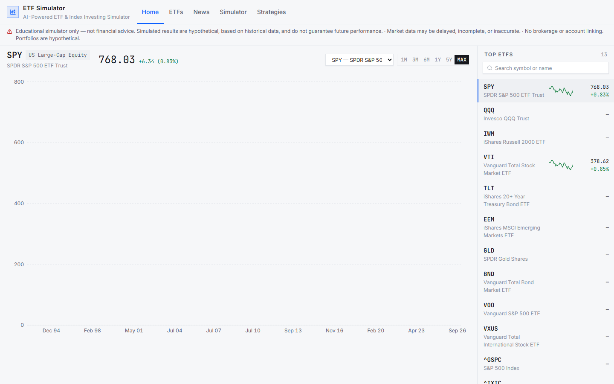
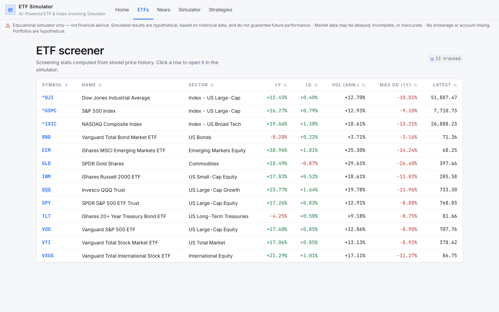
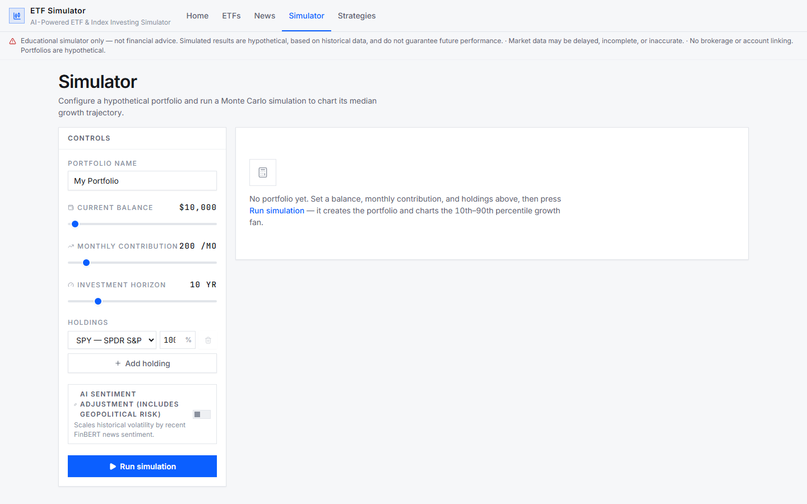

# AI-Powered ETF & Index Investing Simulator

An educational web application that simulates and analyzes long-term ETF and
index investing strategies using historical market data, Monte Carlo simulation,
and financial/geopolitical news sentiment analysis with FinBERT.

> **Educational simulator only.** This project does not provide financial advice.
> Simulated results are hypothetical and not a guarantee of future performance.

---

## Project submission

| | |
|---|---|
| **Group** | Udit Bhattarai, Lotus Nyaupane, Dipen Gaihre |
| **Repository** | https://github.com/uditbh123/AI-Powered-ETF-Index-Investing-Simulator |
| **Demo video (≤ 10 min)** | `<PASTE YOUTUBE LINK HERE>` — must play without being signed in |
| **Timeline** | 8 weeks, ~135 h/person (~405 h total) |

### Final results

A complete, deployed, end-to-end application — not a prototype:

- **9 frontend pages** (Home, ETF screener, per-ETF analysis, Financial News,
  Macro Economy, Simulator, Portfolios, Investing Strategies, 404) behind a
  React 19 + Vite SPA.
- **18 API endpoints** on a FastAPI backend (health, tickers, prices, per-ETF
  analysis, screener, news, portfolios CRUD, Monte Carlo simulate, crisis
  replay, cached run fetch, macro indicators, provider status).
- **375 backend tests passing**, `ruff` (F rules) clean, `oxlint` clean,
  production frontend build succeeds.
- **Single-container Docker image** (`etf-simulator`) shipping the SPA, the API,
  and a frozen SQLite data snapshot — no external services required at runtime.
- **Honest sentiment validation** (see [results below](#sentiment-pipeline--validation)):
  the FinBERT→volatility signal was weak/noisy, so the adjustment band was kept
  deliberately narrow and the negative finding is documented rather than hidden.
- **Hardened** against the main failure modes found during testing: unbounded
  simulations (load-shedding with `503`), non-finite price rows, path-traversal
  on the SPA fallback, and accidental dependency leakage into the runtime image.

### Roles and hours

_The project plan allocated ~135 h/person over 8 weeks. Fill in the actual
per-member hours and confirm the role split below before submitting._

| Member | Role | Hours |
|---|---|---|
| Udit Bhattarai | `<role>` — backend, deployment | `<h>` |
| Lotus Nyaupane | `<role>` | `<h>` |
| Dipen Gaihre | `<role>` | `<h>` |

### What we learned

- **Validation can fail, and that is a result.** The sentiment→volatility
  hypothesis barely survived testing (only one series reached p < 0.05). Rather
  than tune the mapping until it looked good, we narrowed the adjustment band and
  documented the negative result — a defensible finding beats an inflated one.
- **Data basis matters more than the model.** Adjusted vs. unadjusted closes,
  dividend treatment, and month-end resampling dominate the output; correctness
  here mattered far more than any algorithm choice.
- **A separation of "build-time" and "run-time" dependencies is a real design
  constraint.** Keeping heavy ML packages off the request path (lazy imports,
  an import-hygiene test) is what lets the production container stay small and
  boot reliably.
- **Conventions must be enforced in exactly one place.** The percentage-vs-fraction
  weight bug (below) taught us that a single shared helper plus a validation rule
  prevents an entire class of silently-wrong results.
- **Test the failure modes, not just the happy path.** The most valuable tests
  turned out to be the ones asserting *bad* behaviour: load shedding, non-finite
  rejection, cache-key isolation, and no-leak guarantees.

### What we would do differently

- **Fix the price-data adjustment basis up front.** Chasing the adjusted-close
  question later touched ingestion, the screener, and the docs at once; deciding
  it in Phase 1 would have saved rework.
- **Define metrics precisely before implementing them.** The upside/downside
  ratio was implemented with a definition that was `null` in the common case and
  had to be redesigned; a one-line spec would have caught it.
- **Add a real user/auth layer earlier** if multi-user was ever plausible — it is
  currently a deliberate single-user limitation.
- **Introduce schema versioning from the start** so constraint changes (e.g. a
  `CHECK (close > 0)`) are ordinary migrations rather than risky table rebuilds
  against a frozen snapshot.

---

## What the app does

1. **Explore** a fixed catalog of 13 ETFs/indices (`SPY`, `QQQ`, `VTI`, `BND`,
   `GLD`, `^GSPC`, …) with a screener of derived stats (returns, volatility,
   drawdown) and a per-ETF in-depth analysis dashboard.
2. **Build a portfolio** (name, monthly contribution, holdings with weights) and
   **run a Monte Carlo simulation** over historical returns to get
   best / median / worst-case trajectories and a full distribution summary.
3. **Read the news** — sector and geopolitical headlines scored by FinBERT — and
   optionally let that sentiment adjust the simulation's short-term volatility.
4. **Replay a crisis** (dot-com 2000, GFC 2008, COVID 2020) and compare the real
   path against simulated confidence bands.
5. **See macro context** — inflation, interest rates, unemployment, GDP — pulled
   from external intelligence sources at ingest time.
6. **Toggle the basis** of any projection to real dollars (inflation-adjusted)
   and/or after capital-gains tax.

Everything runs entirely on a local SQLite snapshot; the deployed API never makes
an outbound call to answer a request.

---

## Tech stack

| Layer | Choice |
|---|---|
| Backend | Python 3.11+ (developed on 3.14), FastAPI, uvicorn |
| Data processing | pandas, NumPy (vectorized Monte Carlo) |
| NLP | Hugging Face `transformers`, pretrained FinBERT (`ProsusAI/finbert`) |
| Database | SQLite, accessed only through a DAO/repository layer |
| Market data | `yfinance` (daily closes, local ingestion) |
| News data | RSS feeds + Google News, plus optional external intelligence providers |
| Frontend | React 19, Vite, Tailwind, Recharts (fan charts), lucide-react |
| Scheduling | APScheduler (daily refresh, dev only) |
| Deployment | Single Docker image (Node build stage → `python:3.13-slim` runtime) |

---

## Repository layout

```
backend/   FastAPI app, SQLite schema, DAO layer, simulation engine, ingest CLIs
frontend/  React (Vite) SPA — routing, pages, components, disclaimer banner
docs/      Methodology, validation, deployment, known issues, audits, screenshots
PROJECT.md Project spec, architecture decisions, and phase plan (source of truth)
AGENTS.md  Binding rules for AI-assisted development on this repo
```

---

## Prerequisites

- Python 3.11+ (developed against 3.14)
- Node.js 20+ and npm

## Quick start (local development)

### Backend

```bash
cd backend
python -m venv .venv
.venv\Scripts\activate            # PowerShell on Windows
pip install -r requirements.txt   # runtime-only deps (no torch / yfinance)
copy .env.example .env            # fill in API keys when you add them
uvicorn app.main:app --reload     # http://127.0.0.1:8000
```

- Health check: http://127.0.0.1:8000/health
- API docs (opt-in — see below): set `EXPOSE_API_DOCS=true`, then `/docs`

### Frontend

```bash
cd frontend
npm install
npm run dev                       # http://localhost:5173
```

Vite proxies `/api/*` to the backend at `http://127.0.0.1:8000`
(`frontend/vite.config.js`), so API calls use relative `/api/...` URLs with no
CORS setup. Other frontend commands:

```bash
npm run lint    # oxlint
npm run build   # production build to dist/
```

---

## Dependency sets (important)

Three requirement files are kept deliberately separate:

| File | Contents | Used for |
|---|---|---|
| `requirements.txt` | API + simulation runtime (FastAPI, uvicorn, pydantic, numpy, pandas) | Running the server; the **Docker image installs only this** |
| `requirements-ingest.txt` | runtime + yfinance, APScheduler, feedparser, scipy, torch, transformers | Local ingestion + FinBERT scoring |
| `requirements-dev.txt` | runtime + pytest, httpx | Running the backend test suite |

The live API **never imports the ingest stack at boot**. Heavy dependencies are
imported inside the function that uses them:

| Package | Lazy import site |
|---|---|
| `torch`, `transformers` | `app/services/sentiment.py` |
| `yfinance` | `app/services/market_data.py` |
| `apscheduler` | `app/scheduler.py` (`create_scheduler`) |
| `feedparser`, `httpx` | `app/services/news_fetch.py` |

`backend/tests/test_import_hygiene.py` enforces this by failing on any
module-level import of an ingest-only package under `app/` (excluding
`app/scripts/`). This matters because the deployed container installs
`requirements.txt` only — a stray top-level `import torch` would be a
production-only `ModuleNotFoundError` that the dev venv cannot reproduce. Tests
that exercise ingest-only modules skip themselves via `pytest.importorskip`.

---

## Database

On startup the app applies `backend/schema.sql` to SQLite
(`backend/simulator.db`, configurable via `DATABASE_URL`) — unconditionally and
idempotently (`CREATE TABLE/INDEX IF NOT EXISTS`), so running against an
existing database and restarting are both safe. Every connection applies
`PRAGMA journal_mode=WAL`, `PRAGMA busy_timeout=5000`, and `PRAGMA
foreign_keys=ON`. All access goes through the DAO layer (`app/dao/`), never raw
SQL in route handlers, so a future Postgres migration is a config change.

Core tables: `tickers`, `prices`, `users`, `portfolios`, `portfolio_holdings`,
`simulation_runs` / `simulation_results`, `news_sentiment`, and `macro_indicators`.

---

## Market data ingestion

A fixed catalog of ETFs/indices lives in `backend/app/data/ticker_catalog.py`.
Pull (or refresh) their daily close history into SQLite:

```bash
cd backend
python -m app.scripts.ingest                  # all tickers, full history
python -m app.scripts.ingest --symbols SPY QQQ --start 2020-01-01
```

Fetching is idempotent (`UNIQUE(ticker_id, date)`) and always rewrites the full
series on the current adjustment basis, so refreshes never create phantom jumps.
The API seeds the catalog on startup and, when `ENABLE_SCHEDULER=true`, refreshes
daily at `REFRESH_HOUR:REFRESH_MINUTE`. See
[docs/data_methodology.md](docs/data_methodology.md) for the price basis,
screener metrics, and resampling rules.

---

## The simulation engine

The engine (`app/simulation/monte_carlo.py`) is a **pure, API-independent module**
validated against analytically solvable baselines (start-of-period contribution
timing, volatility drag, bootstrap matching).

- **Monthly returns**: daily closes are resampled to month-end per holding,
  aligned, and combined into a portfolio return series as `(returns · weights)`
  over weights normalized to sum to 1. The model implicitly **rebalances to
  target weights monthly**.
- **Bootstrap**: the engine resamples the historical monthly return series
  (vectorized in NumPy, no Python-level loop over paths), with an optional
  block-bootstrap mode. Contributions are applied at the **start** of each month
  (annuity-due), matching the closed-form baseline.
- **Percentiles**: 10 / 50 / 90 hard-coded bands for the fan chart.
- **Distribution stats**: probability of profit, final percentiles, median max
  drawdown, upside/downside ratio, and a 20-bin histogram, persisted with the run.
- **Caching**: identical parameter sets are cached in SQLite
  (`simulation_runs`/`simulation_results`); a repeat returns `"cached": true`.
  Every option that changes the result is part of the cache key.

Full methodology: [docs/data_methodology.md](docs/data_methodology.md).

---

## Sentiment pipeline & validation

News for both **sector** and **geopolitical/macro** categories is fetched, scored
by FinBERT (`P(positive) − P(negative)`, in `[-1, 1]`), and stored in
`news_sentiment`. When `use_sentiment: true` is passed to a simulation, the
aggregate score maps to a volatility multiplier applied to the bootstrap
dispersion:

| Score | Volatility multiplier |
|---|---|
| −1.0 (very negative) | 1.10x (wider fan) |
| 0.0 (neutral) | 1.00x (no adjustment) |
| +1.0 (very positive) | 0.95x (narrower fan) |

The band is **deliberately narrow** because our own validation found the
sentiment→volatility correlation weak/noisy — none of the forward signals
survived the 0.05 bar, and only SPY sector trailing vol reached p = 0.035. The
negative-vs-positive asymmetry is retained (leverage effect, Black 1976). See
[docs/sentiment_validation.md](docs/sentiment_validation.md) for the full result
table and interpretation.

Geopolitical risk is **not** a separate subsystem — it is extra input to the same
pipeline, exactly as scoped in `PROJECT.md`.

### External intelligence sources

Three optional upstreams complement RSS. They add (a) what is being said *now*
(Grok, Perplexity) and (b) hard macro numbers (Trading Economics). All are
**ingest-only** — the deployed API needs no provider key and makes no outbound
call to answer a request. They are fetched by
`python -m app.scripts.intel_ingest`, scored with the same FinBERT model, and
written into the existing tables (`news_sentiment`, `macro_indicators`), so they
surface through `GET /news` and `GET /economy/indicators` with **no schema change
beyond the new table** and **no new runtime dependency** (stdlib `urllib` +
`html.parser`). Full details, keys, and caveats:
[docs/data_methodology.md](docs/data_methodology.md#external-intelligence-sources).

---

## API reference

Interactive docs are opt-in: set `EXPOSE_API_DOCS=true` to mount `/docs`,
`/redoc`, and `/openapi.json`. By default they are **not served** (the schema
publishes internal bounds — reconnaissance for the workload ceiling).

| Method | Path | Purpose |
|---|---|---|
| GET | `/health` | Liveness + DB connectivity |
| GET | `/` | Serves the SPA if built, else API info JSON |
| GET | `/tickers` | Catalog with per-ticker row counts and date range |
| GET | `/tickers/{symbol}/prices` | Stored daily close history |
| GET | `/tickers/{symbol}/analysis` | In-depth per-ETF analysis dashboard data |
| GET | `/screener` | Derived screening stats for every tracked ticker |
| GET | `/news` | Scored headlines by category/window, with aggregate score |
| POST | `/portfolios` | Create a portfolio (name, contribution, holdings) |
| GET | `/portfolios` | List portfolios |
| GET | `/portfolios/{id}` | Portfolio detail with holdings |
| PATCH | `/portfolios/{id}` | Full replacement of name, contribution, holdings |
| DELETE | `/portfolios/{id}` | Delete a portfolio and its runs/results/holdings |
| GET | `/portfolios/{id}/monthly-returns` | The portfolio's monthly return series |
| POST | `/portfolios/{id}/simulate` | Run a Monte Carlo simulation (cached) |
| POST | `/portfolios/{id}/crisis-replay` | Replay a fixed historical crisis window |
| GET | `/simulation-runs/{id}` | Fetch a cached run's results |
| GET | `/economy/indicators` | Stored macro indicators |
| GET | `/economy/providers` | Which intelligence providers are configured |

`POST .../simulate` accepts `initial_balance`, `horizon_months`, `n_simulations`,
optional `seed` / `blocks`, optional `use_sentiment`, and optional
`adjust_for_inflation` / `apply_capital_gains_tax`.

---

## Holding weights are fractions

**One convention everywhere: a holding weight is a fraction in `(0, 1]`, and a
portfolio's weights sum to `1.0` (within `0.01`). A whole sleeve is `1.0`.**

```jsonc
// 60/40 split -- correct
{ "holdings": [{ "symbol": "VTI", "weight": 0.6 },
               { "symbol": "BND", "weight": 0.4 }] }

// 60/40 sent as percentages -- 422, with "0.6 (i.e. 60%) looks right"
{ "holdings": [{ "symbol": "VTI", "weight": 60 },
               { "symbol": "BND", "weight": 40 }] }
```

The rule is enforced in one place (`WEIGHT_SUM_TOLERANCE` in `app/schemas.py`).
A percent-scale payload is rejected on purpose: it would otherwise be silently
renormalized by the engine into a uniform allocation that returns plausible but
wrong statistics. The UI shows and accepts **percents** (how allocation is read
aloud) and converts on submit through a single shared helper,
`holdingsToFractions` in `frontend/src/api.js` — a second inline `/ 100` is how a
100x-too-large allocation gets submitted.

---

## Real-world basis switches

Nominal dollars flatter every long-term projection, so a run can optionally be
reported on a real basis. Two booleans on `POST /portfolios/{id}/simulate`, both
defaulting to `false`:

| Param | Effect |
|---|---|
| `adjust_for_inflation` | Deflate every path by `(1 + rate) ** (t / 12)` |
| `apply_capital_gains_tax` | Charge tax on the final value of profitable paths |

Rates are module constants (`INFLATION_ANNUAL_RATE = 0.03`,
`CAPITAL_GAINS_TAX_RATE = 0.15`), not client-supplied. The adjustment is applied
**after** the Monte Carlo draw, never to the returns feeding the bootstrap; the
book value is deflated by the same factor so probability-of-profit stays
meaningful. Every rate reads back as `0.0` when its toggle is off, and both
toggles are part of the cache key. Full reasoning and caveats:
[docs/data_methodology.md](docs/data_methodology.md#real-world-adjustments-tax--inflation).

---

## Frontend pages

| Route | Page |
|---|---|
| `/` | Home — dashboard, price chart, watchlist |
| `/etfs` | ETF screener (sortable derived stats) |
| `/etfs/:symbol` | In-depth per-ETF analysis dashboard |
| `/news` | Financial news with sentiment |
| `/economy` | Macro indicators + provider status |
| `/simulator` | Monte Carlo simulator with crisis replay |
| `/portfolios` | Portfolio builder and list |
| `/strategies` | Curated strategy cards that hand off to the Simulator |
| `*` | 404 |

A Strategies card deep-links to the Simulator with an allocation pre-filled via
`/simulator?holdings=VTI:54,VXUS:36,BND:10`. Weights in that URL are **percents**
(matching the form's editing surface) and convert to fractions only through the
shared helper; both halves of the contract live in
`frontend/src/strategyHoldings.js`.

The API base is built in `frontend/src/api.js` (default `'/api'` in dev via the
Vite proxy; the Docker build overrides `VITE_API_BASE_URL=/`).

---

## Tests

From `backend/`:

```bash
.venv\Scripts\activate
pytest                      # 375 tests
```

- The **engine** (Phase 2) is validated against analytic baselines and
  schema/connection integrity checks.
- The **DAO and ingestion layers** run against a temp SQLite file with mocked
  fetch output — tests never touch the network.
- **`test_import_hygiene.py`** enforces the runtime/ingest import split.
- Ingest-only tests self-skip on a runtime-only venv (`pytest.importorskip`).

Lint / typecheck:

```bash
# backend
python -m ruff check app tests scripts --select F

# frontend
npm run lint
```

---

## Frontend pages and screenshots

The institutional light-theme UI. Every page at desktop (1440×900) and mobile
(390×844) widths lives in `docs/screenshots/light-theme/`; dark-theme history is
under `docs/screenshots/before|after/`, and focused keyboard states are in
`docs/screenshots/light-theme/controls/`.







---

## Deployment

The whole app ships as **one container image** (`etf-simulator`): the built SPA,
the API, and a frozen SQLite snapshot. No volumes or secrets are required.

```bash
docker build -t etf-simulator:latest .
docker run -d --name etf-sim -p 8000:8000 etf-simulator:latest
curl http://localhost:8000/health     # {"status":"ok",...}
```

The runtime stage installs `requirements.txt` only and boots the frozen
`deploy.db` snapshot (`ENABLE_SCHEDULER=0`); live ingestion happens on your
machine. `/simulate` and `/crisis-replay` shed load with `503` + `Retry-After`
under concurrency rather than queueing. Full instructions (Docker Compose,
Fly.io, Railway, snapshot procedure, verification commands):
[docs/deployment.md](docs/deployment.md).

---

## Known issues and scope boundaries

Deliberately accepted limitations are documented, with evidence and reasoning, in
[docs/known_issues.md](docs/known_issues.md):

1. **No authentication / authorization** — single-user by design.
2. **Runtime/ingest import split is a convention**, enforced by a regression test.
3. **`prices` has no `CHECK (close > 0)`** — contained in three layers instead.
4. **Admission control is global** (per-process load shedding), not per client.

Scope boundaries (from `PROJECT.md`): no real brokerage/account linking; the app
is educational, not advice, and says so visibly; geopolitical risk is extra
sentiment input, not a new subsystem.

---

## Documentation index

| Doc | Contents |
|---|---|
| [PROJECT.md](PROJECT.md) | Spec, architecture decisions, phase plan (source of truth) |
| [docs/data_methodology.md](docs/data_methodology.md) | Price data, screener, resampling, bootstrap, stats, external sources |
| [docs/sentiment_validation.md](docs/sentiment_validation.md) | FinBERT vs. realized volatility results and interpretation |
| [docs/deployment.md](docs/deployment.md) | Single-container build, snapshot, hosting |
| [docs/known_issues.md](docs/known_issues.md) | Accepted limitations with evidence |
| [docs/ai_usage_log.md](docs/ai_usage_log.md) | AI-assisted change log |
| [docs/manual_test.md](docs/manual_test.md) | Manual test notes |
| [docs/runtime-architecture.html](docs/runtime-architecture.html) | Rendered runtime architecture diagram |
| [AGENTS.md](AGENTS.md) | Development rules and conventions for this repo |

---

## Development workflow

- Build one phase at a time (see `PROJECT.md` section 5), verify, commit, then
  move on. Never sweep unrelated changes into a commit.
- From Phase 1 on, all SQLite access goes through the DAO layer.
- Keep the runtime/ingest import split intact (the hygiene test guards it).
- Keep the percent→fraction conversion in the single shared helper.
